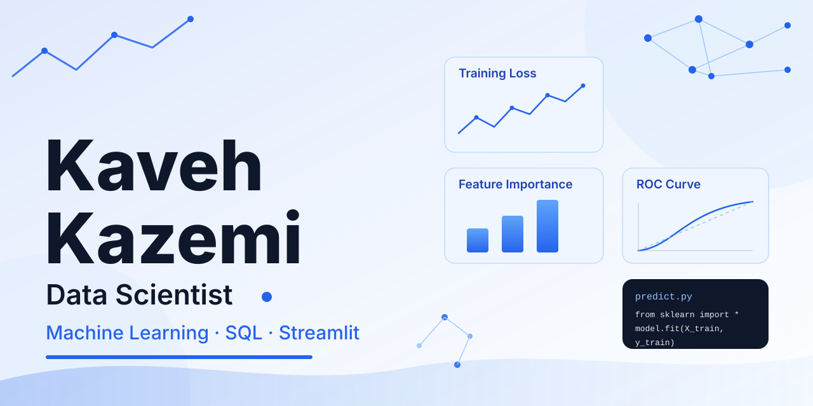

# Hi, I'm Kaveh 👋

**Data Scientist** — I build machine-learning models that explain
themselves, and turn them into something a business can actually use.

## What I do

- **Machine Learning:** classification, forecasting, and NLP — with honest
  evaluation (ROC-AUC, Precision/Recall/F1), not accuracy alone
- **Explainability:** SHAP and clear feature analysis, so a model is a
  decision tool, not a black box
- **End-to-end delivery:** clean Python, reproducible pipelines, and
  Streamlit demos — from raw CSV to something you can click through

## Tech stack

`Python` · `pandas` · `NumPy` · `scikit-learn` · `XGBoost` · `LightGBM` ·
`SHAP` · `SQL` · `Streamlit` · `Matplotlib`

## Featured project

### 📉 [Telecom Customer Churn Prediction](https://github.com/KavehDs/telecom-customer-churn-prediction)

Predicting which telecom customers will leave — Logistic Regression,
XGBoost and LightGBM compared on a stratified test set, with SHAP
explaining the top drivers.

- **Best ROC-AUC: 0.835** (Logistic Regression, test set n = 1,407)
- **Churn F1: 0.61** across all three models
- **Top driver:** month-to-month contract, followed by tenure and
  monthly charges
- Includes a Streamlit demo, reproducible training script, and full
  results in `metrics.json`
- **Live demo:** [Try the churn app](https://wkntyf9xvvupgdezhbuzek.streamlit.app/)

## Focus areas

- Customer churn & retention — [Telecom Customer Churn Prediction](https://github.com/KavehDs/telecom-customer-churn-prediction) · [Live demo](https://wkntyf9xvvupgdezhbuzek.streamlit.app/)
- Demand / sales forecasting — [Retail Sales Forecasting](https://github.com/KavehDs/retail-sales-forecasting) · [Live demo](https://afsrgo7adfcexiaoutsbty.streamlit.app/)
- NLP & LLM applications — [Sentiment Analysis & RAG Q&A](https://github.com/KavehDs/sentiment-analysis-and-rag-qa) · [Live demo](https://gkha5ybqsvsmnyagzjeakj.streamlit.app/)
- SQL & business analytics — [SQL E-commerce Analytics Dashboard](https://github.com/KavehDs/sql-ecommerce-analytics-dashboard) · [Live demo](https://7hdfbygbq4tzibzccmp9eu.streamlit.app/)
- Diabetes risk prediction — [CDC Diabetes Risk Prediction](https://github.com/KavehDs/cdc-diabetes-risk-prediction) · [Live demo](https://dmpcges8zubzu8psyweucw.streamlit.app/)
- Medical image classification — [Breast Cancer Diagnosis Prediction](https://github.com/KavehDs/breast-cancer-diagnosis-prediction) · [Live demo](https://kwjxdvgpjpiacjq4ehemvd.streamlit.app/)
- Hospital readmission — [Diabetes Hospital Readmission Prediction](https://github.com/KavehDs/diabetes-readmission-prediction) · [Live demo](https://njsq2g7jm5yc5qzdv39x4s.streamlit.app/)
- Heart disease risk prediction — [Heart Disease Risk Prediction](https://github.com/KavehDs/heart-disease-risk-prediction) · [Live demo](https://4u6uuezerpn2c6k68c6jdz.streamlit.app/)
- Chest X-ray pneumonia classification — [Pneumonia X-ray Classification](https://github.com/KavehDs/pneumonia-xray-classification) · [Live demo](https://pfdubaypbxrm8zkk7tjv9t.streamlit.app/)

## Open to

Remote Data Science roles and collaborations — **worldwide**. Open to
relocation for the right role.

---

> 🚧 This profile is being built out — more projects are on the way.
> Education, experience and location details to be added here.
